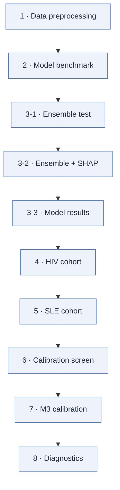

# IPAgeGap----Taisheng Model

[](https://www.python.org/)
[](https://www.r-project.org/)
[](LICENSE)

**Basic code and data processing for the Taisheng model to quantify immune-physiological status.**

This repository contains the core code and data-processing pipeline of the **iAgeGap / IPAgeGap (immune age gap)** study. The workflow starts from raw clinical check-up data, systematically compares multiple regression models, builds an XGBoost ensemble model with feature-attribution analysis, processes two independent validation cohorts (HIV and SLE), and finally compares several residual-calibration strategies on a healthy test set, selecting **M3** as the final model and reporting diagnostic results.

Related web tool: **[IPAge — Immune Physiological Status Assessment Platform](https://imuage.nanhulab.ac.cn/)**

> **Preprint (to be added):** The preprint URL for this study will be inserted here once available.  
> _Placeholder — replace this line with the preprint link._

---

## Table of Contents

- [Workflow](#workflow)
- [File Overview](#file-overview)
- [Dependencies](#dependencies)
- [Data Preparation](#data-preparation)
- [Running the Pipeline](#running-the-pipeline)
- [Models and Calibration Methods](#models-and-calibration-methods)
- [Outputs](#outputs)
- [Citation](#citation)
- [License](#license)

---

## Workflow



Run the scripts in filename order: `1 → 2 → 3-1 → 3-2 → 3-3 → 4 → 5 → 6 → 7 → 8`.

---

## File Overview

| No. | File | Language | Purpose |
| :--- | :--- | :---: | :--- |
| 1 | `1.data_processing_of_xiehe_physical_test.R` | R | Preprocessing of check-up data: item-wise extraction, cleaning and filtering; generates the training and test sets |
| 2 | `2.multiple_model_test.py` | Python | Grid-search benchmark of seven regression models: GB, Lasso, MLP, Random Forest, Ridge, SVR and XGBoost |
| 3-1 | `3-1.multiple_xgboost_model_ensemble_test.py` | Python | Stability of feature importance across ensemble sizes (top-feature overlap ratio) |
| 3-2 | `3-2.ensemble_model_train.py` | Python | Trains a 20-model XGBoost ensemble, computes ensemble SHAP values and generates plots |
| 3-3 | `3-3.ensemble_model_results.py` | Python | Reports performance metrics, true-vs-predicted, residual and learning-curve plots, and SHAP diagnostics |
| 4 | `4.HIV_data_processing.R` | R | HIV cohort processing: outpatient record parsing, feature matching and validation-set construction |
| 5 | `5.SLE_data_processing.R` | R | SLE cohort processing: SLEDAI grade mapping, visit-ID deduplication and validation-set construction |
| 6 | `6.calibration_test_healthy.R` | R | Residual iAgeGap calibration on the healthy test set: screening of calibration strategies and cross-fitting checks |
| 7 | `7.calibration_M3_healthy.R` | R | Applies the selected M3 model (quadratic × sex) and exports calibrated results for all cohorts |
| 8 | `8.calibration_diagnostics.R` | R | Calibration diagnostics: M1–M4 cross-fitted comparison, coefficient verification and age-stratified bias checks |

---

## Dependencies

### Python

```bash
pip install numpy pandas scikit-learn xgboost shap matplotlib
```

### R

```r
install.packages(c("dplyr", "readxl", "splines", "ggplot2"))
```

> Note: Scripts 6–8 read Excel files with `readxl::read_excel` and read CSV files assuming **GB18030** encoding.

---

## Data Preparation

Because the data are sensitive medical records, **no raw or intermediate data files are included in this repository**. Before running, place the required files in the working directory according to the filenames configured in each script.

Key input / intermediate files:

| File | Generated by | Used by |
| :--- | :--- | :--- |
| `体检明细.csv`, `体检首页+基本信息.csv` | raw data | Script 1 |
| `xiehe_all_train_data_20260312.csv` | Script 1 | Scripts 2, 3-1, 3-2, 3-3 |
| `xiehe_all_test_data_20260312.csv` | Script 1 | Scripts 2, 3-1, 3-2, 3-3 |
| `HIV_prediction_results_with_sex_healthy.xlsx` | after Script 4 | Scripts 6, 7, 8 |
| `final_results_3_levels_20_70_with_original_ids_and_sex_healthy.csv` | after Script 5 | Scripts 6, 7, 8 |
| `ensemble_results/` (best parameters, models, SHAP values, etc.) | Scripts 3-1, 3-2 | Scripts 3-2, 3-3 |

> Note: Scripts 4 and 5 contain absolute paths to the original data (e.g. `E:/...`, `C:/Users/...`). Adjust these to your local setup. All paths that need editing are grouped in the configuration section at the top of each script.

---

## Running the Pipeline

Execute the scripts in order from the code directory (each script depends on outputs from the previous ones):

```bash
# R: data preprocessing
Rscript 1.data_processing_of_xiehe_physical_test.R

# Python: model benchmarking and ensemble
python 2.multiple_model_test.py
python 3-1.multiple_xgboost_model_ensemble_test.py
python 3-2.ensemble_model_train.py
python 3-3.ensemble_model_results.py

# R: validation cohort processing
Rscript 4.HIV_data_processing.R
Rscript 5.SLE_data_processing.R

# R: healthy-set calibration and diagnostics
Rscript 6.calibration_test_healthy.R
Rscript 7.calibration_M3_healthy.R
Rscript 8.calibration_diagnostics.R
```

Scripts 3-1 and 3-2 include switches such as `do_grid_search` and `do_train_models`: set them to `True` for the first run to train and save results, then to `False` in later runs to reuse the saved artifacts.

---

## Models and Calibration Methods

**Modeling stage (Scripts 2, 3)**

- Seven regression models are compared: Gradient Boosting, Lasso, MLP, Random Forest, Ridge, SVR and XGBoost, using grid search with 5-fold cross-validation and MAE / R² for evaluation.
- After selecting XGBoost, ensemble stability is assessed by the Top-20 feature overlap ratio across 1–100 models trained with different random seeds; the final model uses an **ensemble of 20 models**.
- The ensemble is interpreted via averaged SHAP values, with summary, heatmap and dependence plots.

**Healthy-set residual calibration (Scripts 6–8)**

Four calibration forms are compared on the healthy test set (`pred` = predicted age, `age` = chronological age):

| Model | Formula | Description |
| :--- | :--- | :--- |
| M1 | `pred ~ age + sex` | Linear, additive |
| M2 | `pred ~ age * sex` | Linear with sex interaction |
| **M3** | `pred ~ (age + age²) * sex` | **Quadratic with sex interaction (final selection)** |
| M4 | `pred ~ ns(age, df=3) * sex` | Natural spline with sex interaction |

Script 8 compares the models by repeated 5-fold cross-fitting (R = 50) using CV-RMSE, maximum age-by-sex cell bias, mean bias in young females, AIC and BIC, and verifies the M3 coefficients. Script 6 additionally performs a 100-repeat cross-fitted residual check (`gap_cf`) confirming that the 95% CI of the age slope after calibration includes zero.

---

## Outputs

- `ensemble_results/`: optimal hyperparameters, ensemble models, stability data, predictions, SHAP values and diagnostic plots (`*.png`).
- Calibration results: calibrated CSV / XLSX files for each cohort, named with suffixes such as `_M3_testcalib_healthy`, plus calibration coefficient files.
- `diag_healthy/`: model comparison table, M3 coefficient verification and stratified bias results generated by Script 8.

---

## Citation

A preprint will be announced; the URL placeholder is retained above and below.

> **Preprint:** _to be added (URL to be inserted here)_

When citing this code, please refer to the repository: <https://github.com/yinxy1992/IPAgeGap>  
Related platform: [IPAge](https://imuage.nanhulab.ac.cn/)

---

## License

Released under the [MIT License](LICENSE).
